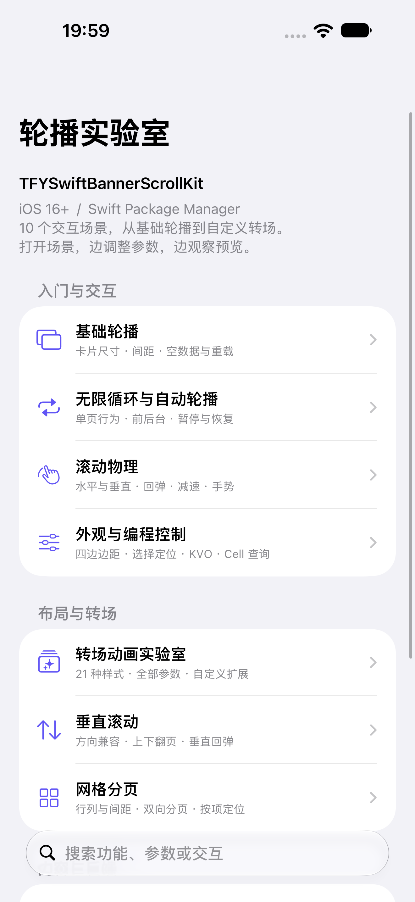

# TFYSwiftBannerScrollKit

原生 UIKit 轮播组件：水平 / 垂直、有限 / 无限轮播、自动翻页、21 种转场、自定义 Cell、网格分页和页面指示器。无第三方依赖。

- 最低 **iOS 16.0**
- Swift 5.7+ / Xcode 14+，使用 Swift 5 语言模式
- Swift Package Manager、CocoaPods、源码集成
- 当前版本 **3.0.1**（3.x 最低支持 iOS 16，升级前请检查宿主部署版本）

## 安装

### Swift Package Manager

清单配置遵循 [Swift PackageDescription 官方文档](https://docs.swift.org/package-manager/PackageDescription/PackageDescription.html)。

Xcode → File → Add Package Dependencies，填入仓库地址：

```text
https://github.com/13662049573/TFYSwiftBannerScroll.git
```

发布 `3.0.1` tag 后，选择 **Up to Next Major Version / 3.0.1**，添加产品 **TFYSwiftBannerScrollKit**。
当前工作区可直接通过 **Add Local** 选择仓库目录验证。Swift Package 的版本由 Git tag 管理，`Package.swift` 声明产品、平台和 Swift 语言模式；本地 tag 需要推送后才能用于远程版本解析。

其他 Package 的清单示例：

```swift
// swift-tools-version:5.7
import PackageDescription

let package = Package(
    name: "MyAppFeature",
    platforms: [.iOS(.v16)],
    dependencies: [
        .package(url: "https://github.com/13662049573/TFYSwiftBannerScroll.git", from: "3.0.1")
    ],
    targets: [
        .target(name: "MyAppFeature", dependencies: [
            .product(name: "TFYSwiftBannerScrollKit", package: "TFYSwiftBannerScroll")
        ])
    ]
)
```

### CocoaPods

对应版本发布到 CocoaPods 后：

```ruby
platform :ios, '16.0'
pod 'TFYSwiftBannerScrollKit', '~> 3.0.1'
```

### 手动集成

将 `TFYSwiftBannerScroll/TFYSwiftBannerScrollKit` 下的 7 个 Swift 文件加入目标。不要同时加入源码和 Package / Pod，否则会产生重复类型。

## 快速开始

```swift
import UIKit
import TFYSwiftBannerScrollKit // 手动将源码加入同一个目标时省略

final class BannerController: UIViewController, TFYSwiftPagerViewDataSource, TFYSwiftPagerViewDelegate {
    private let pager = TFYSwiftPagerView()
    private let indicator = TFYSwiftPageControl()
    private var images: [UIImage] = []

    override func viewDidLoad() {
        super.viewDidLoad()
        pager.translatesAutoresizingMaskIntoConstraints = false
        indicator.translatesAutoresizingMaskIntoConstraints = false
        view.addSubview(pager)
        view.addSubview(indicator)
        NSLayoutConstraint.activate([
            pager.topAnchor.constraint(equalTo: view.safeAreaLayoutGuide.topAnchor),
            pager.leadingAnchor.constraint(equalTo: view.leadingAnchor),
            pager.trailingAnchor.constraint(equalTo: view.trailingAnchor),
            pager.heightAnchor.constraint(equalToConstant: 220),
            indicator.topAnchor.constraint(equalTo: pager.bottomAnchor, constant: 8),
            indicator.leadingAnchor.constraint(equalTo: view.leadingAnchor),
            indicator.trailingAnchor.constraint(equalTo: view.trailingAnchor),
            indicator.heightAnchor.constraint(equalToConstant: 28)
        ])
        pager.register(TFYSwiftPagerViewCell.self, forCellWithReuseIdentifier: "banner")
        pager.dataSource = self
        pager.delegate = self
        pager.isInfinite = true
        pager.automaticSlidingInterval = 3
        indicator.setFillColor(.systemGray3, for: .normal)
        indicator.setFillColor(.systemIndigo, for: .selected)
    }

    func update(images: [UIImage]) {
        loadViewIfNeeded()
        self.images = images
        indicator.numberOfPages = images.count
        pager.reloadData()
    }

    func numberOfItems(in pagerView: TFYSwiftPagerView) -> Int { images.count }

    func pagerView(_ pagerView: TFYSwiftPagerView, cellForItemAt index: Int) -> TFYSwiftPagerViewCell {
        let cell = pagerView.dequeueReusableCell(withReuseIdentifier: "banner", at: index)
        cell.imageView?.image = images[index]
        cell.imageView?.contentMode = .scaleAspectFill
        cell.imageView?.clipsToBounds = true
        return cell
    }

    func pagerView(_ pagerView: TFYSwiftPagerView, didChangeIndex index: Int) {
        indicator.currentPage = index
    }
}
```

所有视图及数据源 / 代理操作在主线程执行。数据源和代理为弱引用，宿主负责持有；数据变化后调用 `reloadData()`。

## 交互 Demo

打开 `TFYSwiftBannerScroll.xcodeproj`，运行共享 Scheme `TFYSwiftBannerScroll`。

菜单按功能分组，支持搜索；每个场景顶部保留实时预览，下方独立滚动参数面板。滑块显示实际数值，支持深色外观和动态字体。卡片尺寸根据预览容器计算，适应 iPhone、iPad 和旋转。

| 场景 | 可操作内容 |
| --- | --- |
| 基础轮播 | 自动 / 自定尺寸、宽高比例、间距、动画跳转、空 / 单 / 多项重载 |
| 无限循环与自动轮播 | 无限开关、单项循环移除、间隔、暂停恢复、离窗重挂载 |
| 滚动物理 | 双向滚动、分页、滚动和手势开关、双向回弹、减速距离、手势状态 |
| 外观与编程控制 | 四边边距、背景、选择取消、定位、Cell / 索引查询、KVO |
| 转场动画实验室 | 无转场、全部 21 种内置样式、自定义扩展、全部 17 个可调参数、布局属性检查 |
| 垂直滚动 | 支持垂直的全部类型、自动翻页、垂直回弹、间距 |
| 网格分页 | 行列间距、双向分页、按项定位、自动按页轮播、进出网格、空数据 |
| 页面指示器 | 双状态颜色 / 描边 / 透明度、路径 / 图片、所有对齐方式、边距、单页隐藏 |
| Cell 与注册方式 | 默认类、自定义类 + CTA、真实 Xib 注册、图片模式、文字、阴影、选中高亮 |
| 数据源与代理事件 | 2 个数据源与全部 12 个代理回调、选择高亮拦截、节流日志 |

<p>


</p>

逐项接口映射见 [公共 API 展示清单](docs/DEMO_API_COVERAGE.md)。

## 使用边界

| 能力 | 约定 |
| --- | --- |
| `itemSize = .zero` / `automaticSize` | 默认铺满可见区域，扣除 `contentInsets` |
| `contentInsets` | 四边留白；手动卡片尺寸下边缘至少保留指定间距，非对称时首尾不保证几何居中 |
| `isPagingEnabled` | 按视口分页；卡片尺寸小于视口时，通常用默认卡片吸附 |
| `decelerationDistance` | `1` 为一项，`automaticDistance` 为按速度自动计算；网格以页计 |
| `scrollOffset` | 普通模式以 item 计；网格以页计；有限模式限制到有效范围，无限模式归一化 |
| `currentIndex` / `didChangeIndex` / KVO | 普通模式代表数据索引；网格代表当前页第一项 |
| `scrollToItem` / `selectItem` | 网格定位到包含目标 item 的整页；空数据或越界请求忽略 |
| `cellForItem` | 仅返回当前可见的 Cell；不可见或越界返回 `nil` |
| `index(for:)` | 返回数据索引；Cell 不属于当前 Pager 时返回 `NSNotFound` |
| `automaticSlidingInterval` | `0` 关闭；离窗、后台、拖动和减速时暂停；空 / 单项不自动翻页 |
| 网格模式 | 有限分页，配置时关闭无限并开启视口分页；退出时自行设置后续循环 / 分页行为 |
| `TFYSwiftPageControl` | 展示型控件，默认不接收点击；宿主同步索引，负页数和越界索引会被限制 |

### 转场与自定义扩展

`PagerViewTransformerType.allCases` 列举全部 21 种类型；`displayName` 提供名称，`supportsVertical` 指示方向兼容性。
仅水平：`overlap`、`linear`、`coverFlow`、`ferrisWheel`、`invertedFerrisWheel`。

```swift
let transformer = TFYSwiftPagerViewTransformer(type: .zoomOut)
transformer.minimumScale = 0.8
transformer.minimumAlpha = 0.5
pager.transformer = transformer
```

继承 `TFYSwiftPagerViewTransformer`，覆盖 `applyTransform(to:)` 与 `proposedInteritemSpacing()` 可实现自定义样式。参考 Demo 的 `DemoTiltTransformer`。
修改自定义转场参数后可调用 `reloadData()` 刷新；`minimumScale`、`minimumAlpha` 和网格参数会自行使布局失效。

### 网格

```swift
pager.configureGridLayout(rows: 2, columns: 3, spacing: 10)
pager.transformer = TFYSwiftPagerViewTransformer(type: .grid)
// 上述顺序与先设置 transformer 均可。
// 指示器：页数 = ceil(itemCount / 6)，currentPage = currentIndex / 6。
```

### 自定义 Cell

继承 `TFYSwiftPagerViewCell`，将内容加入 `contentView`。可使用类或 `UINib` 注册。
默认 `imageView`、`textLabel` 按需创建；`isShadowEnabled` 默认为 `false`。宿主负责网络图片加载与取消请求，重用时清除宿主创建的异步状态。

## 优点与限制

优点：无依赖、UIKit 原生、可复用 Cell、按可见区域计算布局、弱引用代理与计时器回调、21 种样式及公开扩展点；Package 与 Pod 使用同一份核心源码。

限制：只发布 iOS UIKit 产品；SwiftUI 需要宿主包装 `UIViewRepresentable`。不包含图片下载 / 缓存、SwiftUI 原生接口或点击式页面指示器。部分转场仅水平；网格不提供无限循环。复杂 3D 动画仍需在目标真机评估视觉与性能。

## 3.0.1 更新

- 同步 CocoaPods 版本、安装示例与 Demo 版本信息为 3.0.1。
- Package 清单明确使用 Swift 5 语言模式，与 CocoaPods 和示例工程保持一致；最低工具链仍为 Swift 5.7 / Xcode 14。
- 补充 Podspec 中的集成方式、10 个交互 Demo 与语言模式说明。
- 保留 3.0.0 的轮播能力、公共 API 和 iOS 16 最低系统要求。

## 3.0.0 更新

- 正式加入 `Package.swift`，产品 / 模块名 `TFYSwiftBannerScrollKit`，包含独立测试目标。
- Package、Pod、Demo 和测试部署版本统一为 iOS 16；补充共享 Scheme。
- 修复空数据、数据缩减、负索引回弹、有限跳转、超大数据源和弱数据源释放的边界。
- 统一网格可见布局、单项布局、按项定位、索引回调与自动轮播的分页计算。
- 修复吸附边界、无限轮播重复区边界、短间隔动画重启及计时器生命周期问题。
- 修复指示器奇偶数量居中、负页数和刷新时序；按数量增减复用图层，状态更新由平方降为线性复杂度。
- 修复 Cell 图片文字创建顺序，支持动态字体并缓存阴影路径；修复 `minimumScale = 1` 的透明度计算。
- Demo 全面补齐公共 API 展示，增加分组搜索、固定预览、全部参数调节、Nib、自定义转场、数据边界和回调日志。

历史：2.1.0 加入 contentInsets / isPagingEnabled / didChangeIndex 与基础网格修复；2.0.6 修复自动滚动与分页；2.0.5 为初始版本。

## 验证与发布

检查范围、已知限制、发布步骤见 [维护记录](docs/MAINTENANCE.md)。真机与 iOS 16 运行结果尚需实际环境验证；在较新模拟器通过不代表 iOS 16 真机验收。

## 作者与许可

田风有 · MIT，详见 [LICENSE](LICENSE)。
